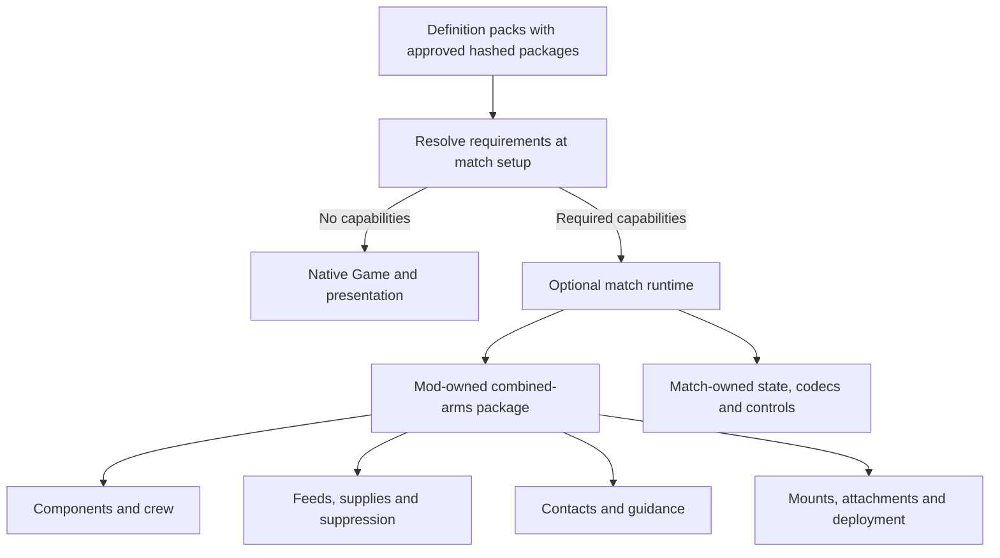

# Content compatibility extension plan

Status: M0–M4 gameplay implementations now live in reusable extension packages in
this mod repository; the game supplies the generic host. See
[EXTENSION-FRAMEWORK.md](EXTENSION-FRAMEWORK.md) for the current architecture. The current **0.4.0**
UCGR integration now binds real source cases in the existing
[`mods/usgr-re`](../mods/usgr-re/README.md) pack: T-90M AP/HE components and
resupply, MiG-29 radar contacts, and HJ-8 deployment with its exposed member,
in addition to the existing magazines and independent mounts. These are
specific verified slices, not a full implementation of every source system.
See the [pack boundaries](../mods/usgr-re/COMPATIBILITY.md).

UCGR remains unfinished. Its `mods/usgr-re` folder is a local ignored draft,
excluded from Git tracking and registry publication until the port is ready.

The user clarified the critical gate: **a few KB of new code is acceptable;
there must be no measurable vanilla runtime degradation.** No percentage
slowdown allowance is granted. Optional feature code/state remains lazy and
native hot bodies remain unchanged. The [external-package refactor evidence](engine-compatibility/2026-10-16-external-packages/README.md)
records the current host extraction. The [earlier isolation evidence](engine-compatibility/2026-10-16-isolation/README.md)
covers cold imports, production startup and retained heap in Chromium and
desktop WebKit, including measurement limits. The [earlier M0–M4 record](engine-compatibility/2026-10-16-m0-m4/README.md)
remains a historical snapshot, not a claim of current pack coverage.

## Goal and ownership

Extend the shared Content System with opt-in, validated gameplay capabilities.
Keep vanilla behavior and existing data-only packs compatible. Legacy built-in
capability content needs explicit compatible packages embedded in format 4;
old saves are not silently rebound to an arbitrary implementation. Restore unsupported source
features only after their actual behavior can be expressed and verified; leave
the omission in place until then.

| Game host owns | Extension package or definition pack owns |
| --- | --- |
| Loading, host ABI, lifecycle, integrity and local approval | Versioned implementation modules and required capability IDs |
| Generic simulation SDK, orders, save/frame bridges and optional kernels | Component, crew, supply, sensor, guidance and assembly algorithms |
| Generic status/action HUD and presentation SDK | Feature drawing/input adapters, localized labels and original art |
| World primitives and content activation | Source setup, deck/economy data and scenarios within supported contracts |

No engine branch may test a UCGR pack ID, source filename, vehicle name or
translated string. A component called `driver` must not gain movement effects
from its name: the pack binds a component state to a movement capability.
Likewise, an ammunition rack, reactor or battery can declare different failure
consequences using the same bounded mechanism.

New content text stays with its package as `[en, zh, ko]` text or world text
references. Only shared interface vocabulary, such as Repair, Disabled and
Reloading, belongs in `core/strings.ts`. Simulation uses stable IDs; changing
language cannot change behavior. Reuse the existing `t()`/`pick()` and content
text lifecycle, including removal when content is disabled. Custom text and
art do not grant packs HTML, CSS or interface-code execution.

## What already exists

Build on these mechanisms rather than create parallel systems:

- `content.ts` and `contentDefs.ts`: additive definitions, format 1/2 packs,
  field tables, validation and activation. The same definitions serve mods,
  worlds and future DLC; definitions remain fixed during a match.
- `combat.ts` and `armor.ts`: damage classes, direct-hit facing multipliers,
  projectile impacts, shields and ability damage reduction. Facing multipliers
  are not a penetration or armor-thickness simulation.
- `ammo.ts`: per-weapon magazines, one magazine charge per burst, base rearming
  and existing automatic return orders. Extend this behavior explicitly; do
  not silently change existing ammunition semantics.
- `ruleSpec.ts`, `ruleState.ts` and `modRules.ts`: validated, bounded behavior
  rules and saved state. New physical systems need their own authoritative
  state, not flags that pretend to be module damage.
- `world.ts`, `worldValidation.ts` and `worldRuntime.ts`: bounded expressions,
  variables, regions, triggers, waves, counters, objectives, scripted results
  and world capability checks. Deck/scenario work belongs here.
- `turrets.ts`, transport, wings, vision and existing audio/art loaders:
  extend their contracts where needed instead of adding RW-specific helpers.

Definition packs add capabilities to their own definitions. They do not obtain
authority to alter global victory, vanilla balance or the interface. Selecting
a world remains the action that starts its scenario; installing or enabling
content never starts one.

## Capability module architecture

Capabilities are versioned executable packages supplied by content and approved
locally. The engine provides a generic host API and no gameplay module catalog.
Package code is trusted JavaScript, not sandboxed configuration. A match resolves its required module
set once at creation; the set and dependency order remain fixed for that match.
A vanilla match keeps the direct runtime. An extended match binds a specialized
runtime with only the required modules and disposes its state on exit.

Each module owns its bounded schema, compiled definition data, participant
indexes, simulation side tables, commands, persistence and visibility policy.
Runtime/UI code loads only for content that needs it. Entity and projectile
objects in vanilla gain no fields, empty containers or feature dispatch hooks.
No global function swapping, per-hit optional callback list, no-op systems or
per-frame extension event bus is permitted.

Shared algorithms remain single-source through build-time specialization. M0's
initial lexical-factory experiment preserved behavior but changed vanilla JIT
binding opportunities. The accepted prototype instead extracts optional kernels
from the canonical Game/combat source, leaving vanilla hot bodies unchanged.
Only extended matches import and bind those generated functions. Shared leaf
helpers are exported; subclass visibility changes erase at TypeScript compile.
The generator runs in check mode during type checks to prevent stale copies.

The M0 architecture gate passed: the complete production web build (47 files)
is byte-for-byte identical to the pre-extension commit. Dated raw comparisons,
exact file hashes and limitations are in
[the M0 evidence](engine-compatibility/2026-10-16-m0/README.md). Final integrations
must repeat the gate; the prototype does not prove unimplemented code.

State is match-owned, keyed by stable entity/component/weapon IDs. Use existing
entity membership/role revisions to update participant indexes. Compose effects
from immutable base definitions; never mutate DEFS or overwrite unrelated buffs.
Server, local play, saves, replay and command consumers must select the same
runtime. Features may not be simulated by observing HP after the vanilla hit:
protection must resolve before damage, attribution and death.

Implementation sequence: baseline commit and frozen fixture → M0 actual combat
seam and paired comparison → M1 protection/components/crew → M2 logistics and
suppression → M3 sensors/guidance → M4 mounts/attachments/deployment → combined
persistence, UI, authoring, content and regression verification. The implementation
record and dated benchmark evidence stay in this mod repository.

## Mandatory vanilla performance gate

The engineering target is zero additional optional-feature work on vanilla
execution paths and zero measurable vanilla performance regression. Literal
identical timings on every machine cannot be guaranteed: code generation,
runtime optimization, garbage collection and measurement noise affect results.
That limitation does not create a slowdown allowance. A repeatable slowdown
must be investigated and removed before the feature ships; inconclusive
measurements are not proof that the gate passed.

### Isolation requirements

- Select the simulation path from the active match's required capabilities at
  setup. Vanilla keeps the existing combat/tick path. Do not accumulate new
  per-unit, per-projectile, per-hit or per-frame checks for features it does not
  use. An early-returning system still has call/branch costs and is not, by
  itself, evidence of zero overhead.
- Optional systems have their own participating-entity indexes and state.
  Do not enlarge every vanilla entity or projectile with new optional slots,
  empty arrays, timers, maps or metadata. Prefer match-owned side tables or a
  separately constructed extended state representation, chosen from measured
  costs. Merely assigning `undefined` can change object size or runtime layout.
- Preserve the ordinary damage and serialization paths. Construct detailed hit
  contexts, component results and resource bookkeeping only on a capability
  path that needs them. Avoid wrappers, generic dispatch or side-table lookups
  added to every vanilla hit in the name of extensibility. Selection of a path
  at match setup must itself be benchmarked for inlining/optimization effects.
- Optional systems are excluded from vanilla render passes, HUD refreshes,
  AI scans, snapshots, frame comparisons and replay work. Vanilla snapshots and
  network frames gain no empty optional payload or additional bytes.
- Keep substantial optional runtime/schema/UI code in content-triggered chunks
  or another equivalent isolation boundary. Audit production bundles: lazy
  loading is defeated if a shared import pulls the feature into startup. Check
  download, parse/compile time and heap as well as simulation speed. Reuse shared
  primitives without maintaining a copied second engine.
- Installed-but-disabled content must not activate a system. An old pack using
  none of the new capabilities incurs none of their runtime work. In a match
  that does use a capability, its users and necessary interactions pay the
  extra cost; it is not possible to isolate CPU time from other units sharing
  that same match or host process.
- On leaving a modded match, release feature-owned state, indexes, listeners
  and assets and restore the vanilla execution path. Test this transition as
  well as a fresh launch. JavaScript module/code caches are not automatically
  unloaded by dropping state; inspect retained memory explicitly and choose a
  disposable runtime boundary if meeting the gate requires it.

### Evidence required before accepting a milestone

Freeze a pre-extension reference build and the exact vanilla fixtures before
implementation. Use the same map, seed, unit counts, orders, graphical settings,
runtime version and build mode. Compare production browser builds and dedicated
server runs, with alternating baseline/candidate order, independent processes
where appropriate, repeated samples and recorded warmup/noise. Keep behavioral
comparison and expensive instrumentation outside the timed production run.

Cover idle play, dense combat, projectile-heavy combat, AI/pathfinding, fog and
hosted replication, including the current capacity fixtures. Include desktop
and representative mobile/WebKit hardware; a fast development machine alone
cannot establish the shipping gate. Measure:

| Area | Required comparison |
| --- | --- |
| Simulation/rendering | Tick and frame distributions, especially p95/p99, dropped simulation time and sustained playable capacity |
| Memory/GC | Allocations, retained heap, entity/projectile footprint and collection pauses |
| Multiplayer/persistence | Serialization time, frame bytes, save/load and replay costs |
| Startup | Vanilla boot/download payload, parse/compile time and time to playable state |
| Lifecycle | Fresh vanilla, installed-but-disabled content, and vanilla after leaving/disabling a feature-using pack |

Report uncertainty and reproducibility, not just rounded FPS or an average.
Do not offset a slower combat path with an unrelated improvement elsewhere or
hide a hardware-specific regression inside an aggregate. Verify structurally
that optional tick/hit/render callbacks and feature allocations are absent in
vanilla. Runtime measurements must corroborate that structure. If noise prevents
a useful conclusion, improve the experiment rather than declare success.

Measure feature-enabled matches separately to show the cost of each capability
and bound its scalability. Those results cannot relax the vanilla gate.

## Delivery sequence

The authorized implementation scope is M0–M4 in one pass, with the mandatory
M0 performance gate before expanding the prototype. M5–M6 remain future work.
Generic component feedback ships inside M1; presentation is not postponed
until the last milestone.

| Milestone | Deliverable | Dependencies and acceptance witness |
| --- | --- | --- |
| M0 — Contract and compatibility | Required feature declarations, bounded schemas, text ownership and persistence/replication decisions | Old packs still load; unsupported required mechanics fail clearly in every loader, including a dedicated server |
| M1 — Armor, components and crew | Opt-in penetration, expendable protection, damageable components, crew replacement and repair; generic HUD and orders | One vehicle completes hit → functional damage → repair/replacement in local and hosted play; an unrelated ship/reactor fixture uses the same data contract |
| M2 — Ammunition, supply and suppression | Shared weapon reload groups, selectable rounds, typed stocks/providers and suppression state | One gun cannot fire AP and HE as independent barrels; service conserves stocks; existing magazine users retain their behavior |
| M3 — Sensing, guidance and obstruction | Designation/illumination, seeker lifecycle, countermeasures and opt-in sight obstruction | A guided weapon acquires, loses and reacquires support according to data without leaking hidden targets |
| M4 — Articulated units | Heterogeneous independent mounts, visible attachments, squads, towing and safe deployment transitions | Independent weapons train separately; attachment casualties and failed deployment leave valid simulation state |
| M5 — Authored deployment matches | World-scoped resources, purchases, capture, phases and deployment/opening policy | A small authored match runs from selection through scoring and victory without a built-in UCGR mode |
| M6 — Remaining presentation and content expansion | Voice hooks, state cosmetics and scoped music; broader pack conversion | Localized content and original feedback work through generic hooks; newly restored units pass feature-specific checks |

M2 follows the M1 state and damage contract. M3 follows M2's weapon/loadout
contract; obstruction can be developed as a separate vision change. Mount
generalization in M4 may be brought forward if needed for a representative
weapon, but squads/towing do not block the first component slice. M5 can be
designed independently once M0 is settled. M6 hooks can ship with their owning
milestones; broad roster expansion follows verified mechanics.

## M0: establish the shared contract

1. Add a coherent required-capability contract for definitions and worlds,
   extending the existing world capability mechanism. Illustrative feature
   names are `components-v1` and `penetration-v1`; final names and encoding
   are part of schema review. Check nested world packs as well as standalone
   packs. `minGame` remains useful metadata, but browser-only version checks
   are insufficient enforcement for a server or registry tool.
2. Choose format/version gates that older readers actually reject. Older
   readers can ignore unknown fields, so a new required-feature field alone
   does not make a pack safe for those readers. Audit existing format and
   minimum-version enforcement before choosing a format increment. A missing
   optional recording can remain silent; a missing required mechanic rejects
   the affected content before a match starts.
3. Specify bounded counts and stable references for components, crew, profiles,
   ammunition and mounts. Reject dangling references, cycles, invalid ranges
   and unsupported combinations. Extend the existing field tables and rule
   readers so editor help, wiki/agent documentation and registry checkers share
   the validator's contract. Do not add an RW expression interpreter.
4. Define one authoritative hit context and result: source attribution,
   payload, hit point/facing, direct/blast origin, resolved protection,
   penetration outcome, hull damage and component consequences. Avoid separate
   damage paths in the UI, AI, rules and projectiles.
5. Document ordering with shields, abilities, damage modifiers, splash, death,
   XP and kill attribution before implementing it. Preserve the existing
   ordering for definitions without the new features. Do not multiply both
   the legacy armor counter row and a new penetration model accidentally.

Review artifacts: proposed schema examples, old/new interaction table, state
and redaction table, validator limits, the vanilla execution/isolation design
and pre-extension performance baseline, and focused acceptance fixtures. These
are design artifacts, not declarations that a proposed field already works.

## M1: component combat implementation and acceptance

Implemented as `components-v1`, with schema, participant state, hit routing,
actions and persistence owned by the optional module. The exact authoring
contract is [M1/M2 authoring](engine-compatibility/M1-M2-AUTHORING.md); values,
labels and the source-derived [T90 study](engine-compatibility/fixtures/T90-SYSTEMS-STUDY.md)
remain in this repository. This is a bounded statistical component model.

### Armor and hit resolution

- Authored front/side/rear sector arcs, top faces, damage-family protection,
  incidence response, ricochet policy, continuous fractional protection wear,
  bounded range adjustment and residual penetration are implemented. A weapon
  must explicitly declare a top hit; a decorative arc does not infer one.
- Each component independently rolls its authored strong/weak channel and
  facing exposure. A blocked penetration may still apply an explicitly authored
  weak channel, as in the source mod. Missing channels cause no internal damage.
  Explicit zero hull damage is supported without losing component effects.
- The module resolves direct/contact impacts. Collateral blast/fragmentation
  retains the ordinary damage pipeline; no volumetric interior or fragment-ray
  model is claimed. Unmatched weapon/target protection families take the
  ordinary HP path without inferred internal hits.
- Shields spend a single energy budget before hull/internal consequences.
  Authored hull damage and terminal component failures use the common damage,
  death and shooter attribution lifecycle. The pack must not count the same
  directional resistance twice in an authored payload.

### Components, crew and repair

- Parts own pack-local IDs, complete localized labels, health, state thresholds,
  exposure and fixed effects. Speed/turn multipliers compose; reload penalties
  add. Named weapons can be disabled. Failure can explicitly damage or destroy
  the hull. No effect is inferred from a component's name.
- Crew identities and fractional health move into empty seats using authored
  priority, replacement relationships and transfer time. Crew creation requires
  an explicit refill service. Occupied-seat swaps and reserve-pool arithmetic
  are omitted; labels such as “loader” do not create implicit behavior.
- Repairs support field/provider eligibility, progress, target damage level,
  optional stationary work, metal/time costs and hit retention. Losing an
  eligible provider cancels work. Ordinary HP healing leaves parts, crew and
  protection unchanged. Optional automatic repair/reassignment uses the same
  module eligibility rules; arbitrary source automation is not implemented.
- Repair, reassign and cancel actions enter through the shared commands/orders
  gateway. The module contributes pack labels, private state and available
  actions to the shared HUD/CLI model. Enemy health, crew identities and task
  progress are not public. Saves validate state bounds and references, including
  launch origins needed by range-dependent penetration. Equal-config deployment
  forms preserve state and tasks.
- Typed component predicates/events for arbitrary behavior rules remain outside
  v1. Unknown extension fields are errors, so an unsupported source formula or
  reaction cannot silently become an approximate implementation.

### Focused acceptance record

`contentModulesCombat.test.ts` passes 16 tests / 82 assertions covering M1 and
M2: authored arcs and fractional wear, independent strong/weak damage, zero hull
payload and one-time shield absorption, crew identity/save continuation, timed
repair/provider interruption/payment, in-flight range context restore, common
death attribution, a ship reactor’s failure and saved repair continuation,
stock/feed/service/suppression behavior and schema rejection.
The source-derived T90 fixture validates without warnings, but deliberately
omits the stock-dependent ammunition-rack threshold, occupied-seat swaps,
source experience/accuracy formulas and other combinations listed in its scope.
It is an acceptance study, not a claim of full T90 or UCGR parity.

Combined hosted play, UI, cross-module fixtures and the final vanilla
performance gate are integration acceptance work; this focused record alone
does not establish their result. The unrelated ship reactor uses the same component data as the vehicle tests;
broader roster acceptance remains pack work.

## M2–M6: implemented modules and remaining scope

### M2: ammunition, logistics and suppression

Implemented as `logistics-v1`, an optional module beside the unchanged ordinary
`ammo.ts` path. Stocks have explicit capacity and initial quantity. Alternative
weapons in a feed share the committed reload clock; selecting a round cannot
reset cooldown or fire another barrel. A stock cost is paid once per committed
burst, including when its remaining rounds continue after the stock reaches
zero. Explicit `refillAfter` is an unlimited timed empty-magazine policy; finite
stocks omit it. Module stocks/feeds cannot also use legacy `ammo` on that weapon.

Providers choose one of two different policies: finite, conserved transfer with
one shared rate budget per provider/service, or explicitly unlimited timed
refill. Recipients consume a transfer budget in stable entity order. Timed refill
can replenish named ammunition, crew and protection; finite crew/protection
transfer is rejected. Range, alliance, state and stationary requirements govern
eligibility. General source currencies, consumable exchange rates, automatic
retreat/rearm behavior and stock-dependent component thresholds are omitted.

Suppression accumulates once per projectile/target, waits through an authored
quiet interval and then decays. The highest reached threshold supplies bounded
movement, reload, scatter and weapon-disable effects. No global morale system
or automatic smoke/retreat reaction is added. Fixed accuracy data supports base
scatter, shooter/target movement, range and target size, sampled with the match
RNG. Explicit accuracy with homing or continuous weapons is rejected; cover,
experience and arbitrary per-target formulas remain omitted.

The focused tests verify shared feed cooldown and burst cost, inventory
conservation across recipients, timed magazine/provider refill, suppression
recovery, seeded scatter, equal-form clock persistence and invalid combinations.
CLI tests add real `content-action` dispatch through shared orders, owner and
spectator rejection, provider/point selectors, full/delta snapshot continuation
and private output filtering (4 tests / 31 assertions). The relevant CLI subset
passes 39 tests / 206 assertions. Old magazine users keep their existing path;
final vanilla and combined integration results are recorded separately.

### M3: sensors, guided weapons and line of sight

Separate observation, target designation, radar illumination, weapon lock and
seeker tracking. Expose typed channels and compatibility rules, target classes,
lock time, tracking loss, reacquisition, guidance lifetime and countermeasure
responses. Anti-radiation weapons consume actual emitter state, not visibility
of every radar-like unit on the map.

Remote operators can designate a target for a separate launcher or one-way
vehicle through explicit relationships, authority and range rules. Do not
reuse a carrier wing if it imposes different targeting/control behavior.
Provide generic launch/strike orders only where the source workflow requires
them; AI uses the same capabilities.

Extend the vision pipeline with opt-in smoke/forest obstruction and firing
reveal policies. Keep visual effects separate from sight blockers. Update
acquisition, attack validation, fog replication and AI knowledge consistently;
hearing or tracking a signal does not automatically reveal a full entity record.
Bound emitter searches and blocker updates through spatial indexes.

### M4: mounts, attachments and deployment

Generalize the existing turret support to separately configured weapons,
targets, transforms, arcs, timing and shared feed groups. Preserve existing
mount semantics when the new data is absent. Mount identity must survive saves,
morphs and replication without relying on array indices that may change.

Visible attachments declare slots, member definitions, pose/firing permissions,
occupancy, damage ownership and what happens when parent or child is destroyed.
Reuse transport/wings where their semantics fit. Squads retain actual members;
a single sprite with multiplied HP is not equivalent. Towing needs explicit
movement/collision and detach rules, with bounded depth and no attachment cycles.

Treat unit-to-building deployment as a validated transition transaction: check
terrain and footprint first, reserve occupancy, transfer the defined state,
then commit. Failure leaves the old unit valid. Define selection, cargo,
health, crew, stocks, orders and cancellation behavior. Do not simply remove
the current same-kind morph restriction and hope occupancy remains correct.

### M5: authored match and deck systems

Extend the World system's current variables, expressions, counters, triggers
and scripted results. Add generic purchase/deployment offers with costs,
availability, cooldown, limits, spawn regions and cancellation/refund rules.
World-owned choices configure decks and phases; typed resource ledgers support
authoritative spending and a generic localized HUD. Capturable objectives
declare eligible captors, contest/ownership rules and effects.

A world can select a deployment/opening policy using mobile command entities
and authored forces. Keep format 2 Conquest faction/HQ requirements intact;
introduce the world-scoped contract needed for another opening. Scoring,
capture income and victory remain authored world rules. Do not create a
hardcoded UCGR game-mode switch or let an enabled definition pack replace
Conquest's rules. Offer the source experience as a world with its packs.

UCGR's SUP/SPP names, 12 decks, platoon recipes and phase tables live in that
world. Its exact 5v5 maps remain a separate capacity decision: current player
and map-side limits must be evaluated across simulation, networking, UI and
mobile performance before increasing them. Do not resize an original map and
call it faithful.

### M6: authored feedback and roster growth

Add generic selection/order voice references, typed state cosmetics and
scenario/faction music selection where needed. Selection voices are local
presentation events, not authoritative orders or globally broadcast audio.
Cosmetics observe only state the viewer may know; they cannot reveal concealed
module damage. Missing optional recordings retain the established silence
policy. Pack assets, labels and recordings remain namespaced and removable.

After each mechanic passes, update the external converter, replace the
corresponding omission with source data, and verify representative behavior
before expanding coverage. Keep source-to-field provenance and EN/ZH/KO text
in the mod repository. Do not re-enable a source unit whose defining behavior
is still unsupported. Definition/asset limits are reviewed from measured
content and runtime costs, not raised to fit the source inventory by default.

## Cross-cutting implementation rules

- **State and performance:** the mandatory vanilla gate above applies to every
  milestone. Allocate component, stock and seeker state only for content using
  it, without increasing vanilla object footprints. Compile validated data into
  bounded access tables. No unconditional component scan over vanilla units and
  no per-projectile search over the entire army. Declare invalidation for
  definition revisions, morphs, capture and removal.
- **Authority:** use the server's fixed simulation clock and `st.rng`. UI and
  render state never choose hit results, spending or repair completion. AI reads
  the same allowed information and issues the same orders as a player.
- **Persistence and fog:** explicitly handle new state in entity initialization,
  snapshots, exact replay keyframes, sanitization, deltas and redaction. Include
  active repair tasks, shared reloads, crew transfers, protection, resources,
  lock state and RNG continuation. Handle absent old fields with legacy defaults.
  Reject corrupt or incompatible state rather than grant extra stocks or crew.
- **Compatibility:** active content agreement includes required capabilities
  and exact pack identity. Test older peers and readers before deciding whether
  additive fields are compatible. Do not bump `PROTOCOL_VERSION` or `SAVE_VERSION`
  merely for a mod; make the decision from the actual serialization change.
  A breaking wire change requires a coordinated four-platform release.
- **Distribution:** regenerate mod/world checker bundles and generated author
  documentation from the owning schemas; keep registry/editor/headless behavior
  consistent. Content installation and activation still do not execute scenarios.
- **Isolation:** no new runtime dependencies, arbitrary scripts, global balance
  overrides or shell-specific gameplay. Generic commands and read models serve
  browser, desktop, mobile, server and CLI.

## Validation and release gates

Each milestone includes schema, simulation, integration and presentation work
needed to make that feature usable. Complete its focused tests once, then
broaden only for changed behavior or remaining uncertainty.

1. Validation: caps, references, unsupported capabilities, invalid combinations,
   adversarial saved state and clear error paths; all existing packs still load.
2. Simulation: bounded seeded fixtures, threshold and stacking cases, mixed
   legacy/detailed interactions, service accounting and death attribution.
3. Commands and AI: ownership, visibility, unavailable actions, interruption,
   manual overrides and representative AI use. No client-only action path.
4. Persistence/network: save during repair/reload/replacement, restore and compare
   continuation; hosted owner/ally/enemy/spectator redaction, late join, reconnect
   and replay seek. Include old-content and unsupported-client cases.
5. Presentation/localization: generic and authored fixtures in EN/ZH/KO; readable
   state/actions at touch sizes; original optional assets loaded and removable.
6. Regression/performance: root `pnpm check`, relevant simulation/server suites
   and the existing behavior corpus, plus the mandatory vanilla performance
   gate. Accept no reproducible degradation on vanilla workloads. Record the
   feature-enabled costs separately; functional success cannot waive this gate.
7. Content acceptance: one real UCGR source case and one unrelated synthetic
   content case per capability, with explicit supported/omitted claims. Then
   update the pack's compatibility report and representative gameplay screenshots.

The M0–M1 implementation review should settle the hit-order table, model
fallbacks, schema bounds, repair resource contract and state privacy together.
Those decisions determine a concrete first patch sequence: schema/validation;
hit resolver; component/crew/service state and orders; serialization/redaction;
HUD/CLI and AI; checker/docs and external pack verification. Do not merge a
loader that accepts required gameplay fields before their runtime and persistence
are ready.
