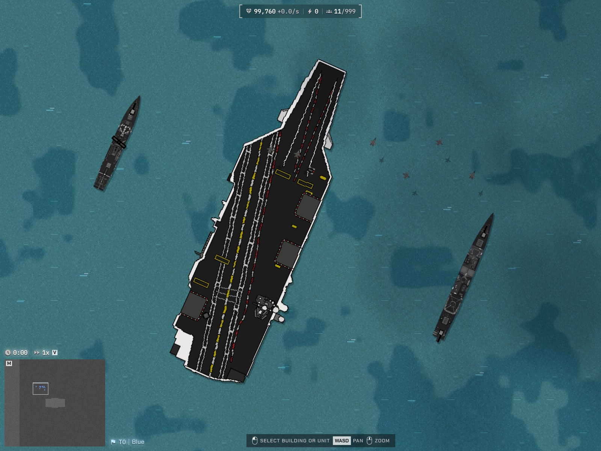

# Naval Warfare

A local Steel Tide port of **NW (NAVAL WARFARE)0.10.1J(UNBalance)The conventional version**.
The supplied pack is the source of the units, descriptions, pictures, weapon
recordings and soundtrack. This is an intentionally unbalanced roster; the
port does not rebalance its damage or HP into Steel Tide's vanilla roster.

**Install:** Settings → Mods → Open folder, then choose this directory.
Alternatively import `dist/naval-warfare.steel-tide-mod` from the repository.
Start a new match and choose a **Naval Warfare** national faction: United
States, Russia, Japan, China or Philippines. The included **Naval Review**
map is a new two-seat showcase, not one of the original oversized RW maps.

The pack requires **extension host API 2** and **large content capacity**.
The game version string alone does not establish those capabilities. Its
executable package is embedded in `mod.json`, so an offline installation
does not need the source RW folder or a separate gameplay library.

## Included

- 285 source units, buildings and alternate forms, including the five original
  Excavators and five original stationary cranes. Every one of the source's 300 INI definitions
  has a disposition in [conversion-report.json](conversion-report.json).
- Original body, independent turret, rotor, projectile and wreck pictures.
  Identical images with identical geometry share sheets; pixels are kept,
  with team recoloring and automatic background removal disabled.
- Every compiled gun is retained in the package, including ships with more
  than eight guns. The ordinary card displays the first eight weapons.
- Source direct/area damage, flat armor and armor penetration, tagged damage
  multipliers, firing arcs, warmup, individual reloads, linked clocks, local
  ammunition, energy regeneration, tagged interception and recoil offsets.
- Deployment and submarine surface/dive forms. Timed factory batches and
  carrier purchases use their source action prices and batch sizes.
  Carriers begin with their source aircraft within valid hold capacity;
  **Launch aircraft** and **Recover aircraft** use the normal content-action
  gateway. Visible deck attachments retain their source offsets.
- Reactor heat/cooling forms and immediate nuclear death blasts. Persistent
  radiation is listed among the unported behaviors.
- 25 distinct source firing recordings and all 13 tracks from the explicitly
  selected `-MUSIC-` directory, converted to portable MP3.
- English, Chinese and Korean unit names/descriptions, action labels and
  faction names. Original English descriptions remain complete; Chinese
  and Korean historical paragraphs are concise translations. Upstream
  historical inaccuracies and mismatched weapon lists are not corrected.

## Playing the port

Each faction starts with its original Excavators, original art, HP, ground
movement and construction reach. The source stores their definitions in
capitalized `.Ini` files. Excavators establish stationary cranes and storage
facilities; select a crane to construct the national factories, airfields,
shipyards and defenses through its content actions. Choose a building, then
click a valid point within the crane's construction radius. Construction
uses the native placement, territory and production-slot checks. The only
extra build edge is HQ reconstruction, required by native setup factions.

Use factories' content actions for ground recruitment. These retain original
action-specific prices and five-second batches; they are separate from an
ordinary production queue. Shipyards and airfields retain the source's
explicit `canBuild` lists. Carriers buy their individual aircraft or mixed
batches into their holds. Launch them, then order them as normal units;
choose **Recover aircraft** on the carrier and select a friendly aircraft
to bring it back. A recovery job handles one aircraft at a time.

Source units that have no producer in the retained national build lists stay
available in the Scenario Editor/console. The conversion report distinguishes
native production, package recruitment, forms and sandbox-only units.
The validator's remaining orphan warnings describe those source extras,
crane-only construction and automatic reactor forms; they are not missing
asset warnings.

The source economy has credits, oil and steel. This port uses Steel Tide
metal, with a declared linear exchange taken from the source HQ purchase
buttons: **100 credits = 1 metal; oil = 90000/1400 credits; steel = 40000/1300
credits**. Income and upfront action costs use the same exchange. Resource
scarcity, three independent balances and original upkeep are not reproduced.
The original profitable buy/sell prices remain profitable after conversion.

World distances use **0.5 world pixel per RW pixel**, including speed, turret
offsets, blast radii and range; RW times use 60 ticks per second. Vision
converts RW's 20-pixel tiles to Steel Tide's 32-pixel tiles and is bounded by
the native 64-tile limit. Converted gameplay stats use at most two decimal
places, including matching weapon-card and package combat values. Internal
angles, art geometry and small simulation coefficients retain their precision.
HP and damage are not compressed. Buildings use larger native-scale layouts:
headquarters, factories and shipyards occupy 3×3 tiles with 96-pixel-wide art;
cranes and helipads occupy 2×2 tiles. Extractors and other support buildings
fill their existing footprint width, and small defenses have at least a
32-pixel-long silhouette. Airfields, reactors and walls keep their source
scale. Each enlargement preserves the artwork's aspect ratio and scales its
turrets, arms, muzzle offsets and wreck together; weapon ranges, damage and
mobile units retain the original conversion. The per-sheet
`buildingScaleFactor` records this adaptation. Other very small art is enlarged
only as required by the four-pixel sheet minimum.

This is a local review build. Read [COMPATIBILITY.md](COMPATIBILITY.md) for
real engine limits, explicit adaptations, remaining package work and source
defects. [CREDITS.md](CREDITS.md) and [LICENSE.txt](LICENSE.txt) record the
unresolved upstream attribution and distribution terms. Nothing has been
published or pushed.

## Rebuild and verify

Run from the repository root, with Python/Pillow, FFmpeg, Node 22+ and Bun.
The simulation/browser tests use the existing sibling `steel-tide-game` checkout
read-only. No game source is copied into the embedded extension.

```sh
python3 mods/naval-warfare/localize.py
node mods/naval-warfare/extensions/naval-systems/build.mjs
python3 mods/naval-warfare/port.py
python3 mods/naval-warfare/make-map.py
bun test mods/naval-warfare/simulation.test.ts
python3 -m unittest discover -s mods/naval-warfare -p 'test_*.py'
node --test mods/naval-warfare/pack.test.mjs
node tools/check.mjs mods/naval-warfare
node tools/pack.mjs mods/naval-warfare
```

`port.py --no-media` rebuilds metadata without transcoding the existing
assets. To repeat the browser acceptance, run the sibling game's existing
Vite server on port 5209, then `node mods/naval-warfare/verify-browser.mjs`.
It installs the actual folder into a disposable Chrome profile and captures
the real game. Evidence is in `verification/browser.json` and `screenshots/`.


